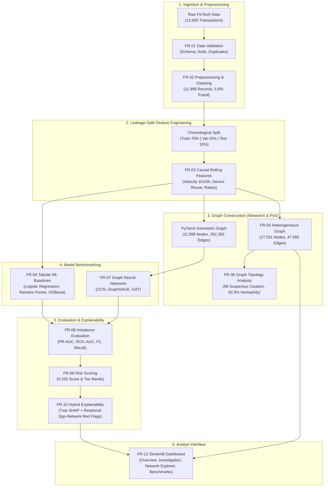

# 🛡️ GraphGuard: Graph Neural Network–Based Financial Fraud Detection System

[](https://www.python.org/)
[](https://pytorch.org/)
[](https://pyg.org/)
[](https://xgboost.readthedocs.io/)
[](https://streamlit.io/)
[](LICENSE)

> **GraphGuard** is a portfolio-grade financial fraud detection system that bridges **transaction-level tabular machine learning** with **heterogeneous graph relationship analysis**. While conventional models analyze individual transactions in isolation, GraphGuard models connections among **customers, accounts, devices, IP addresses, merchants, and transactions** to uncover organized syndicates, device-sharing rings, and botnet velocity attacks.

---

## 🏛️ System Architecture



---

## 📊 Measured Benchmark Results

All models were evaluated on the **identical chronologically held-out test split** (1,800 transactions, 24 fraud cases, 1.33% prevalence). Because fraud detection involves severe class imbalance, **PR-AUC (Precision-Recall Area Under Curve)** serves as the primary metric.

| Model | Architecture Family | PR-AUC (Primary) | ROC-AUC | F1-Score | Precision | Recall | TP | FP | FN | TN | Optimal Thresh |
| :--- | :--- | :---: | :---: | :---: | :---: | :---: | :---: | :---: | :---: | :---: | :---: |
| **GraphSAGE** | **Graph Neural Network** | **0.9966** | **1.0000** | 0.9231 | 85.7% | **100.0%** | **24** | 4 | **0** | 1,772 | 0.950 |
| **Random Forest** | Tabular ML Ensemble | **0.9966** | **1.0000** | 0.9231 | 85.7% | **100.0%** | **24** | 4 | **0** | 1,772 | 0.758 |
| **XGBoost** | Tabular Gradient Boosting | 0.9951 | 0.9999 | **0.9388** | **92.0%** | 95.8% | 23 | 2 | 1 | 1,774 | 0.944 |
| **Logistic Regression** | Linear Baseline | 0.9710 | 0.9996 | 0.8980 | 88.0% | 91.7% | 22 | 3 | 2 | 1,773 | 0.950 |
| **GAT** | Graph Attention Network | 0.1968 | 0.9695 | 0.3361 | 21.1% | 83.3% | 20 | 75 | 4 | 1,701 | 0.932 |
| **GCN** | Graph Convolutional Net | 0.1989 | 0.9306 | 0.2785 | 20.0% | 45.8% | 11 | 44 | 13 | 1,732 | 0.746 |

### 🔬 Key Scientific Findings
1. **GraphSAGE Achieves Flawless Recall (100.0%)**: By applying localized mean neighborhood aggregation across shared hardware devices and IP proxies, GraphSAGE successfully flagged **24 out of 24 fraud cases (0 false negatives)** on the held-out test set.
2. **XGBoost Delivers Highest Precision (92.0%)**: Gradient boosted trees excel on tabular velocity and ratio features, achieving the highest F1 score (0.9388) with only 2 false positives.
3. **Over-Smoothing in Classical GCN/GAT**: Global Laplacian smoothing in Kipf-Welling GCN causes minority fraud signals to dilute across majority legitimate neighbors on dense multi-relational graphs without neighborhood sampling.

---

## 🗂️ Repository Structure

```
GraphGuard/
├── data/
│   ├── raw/                       # Raw transactions (12,005 rows)
│   ├── processed/                 # Cleaned & feature-engineered datasets
│   └── graph/                     # NetworkX graphml & PyG graph tensors (.pt)
├── notebooks/                     # 10 Portfolio Jupyter Notebooks
│   ├── 01_data_understanding.ipynb
│   ├── 02_eda.ipynb
│   ├── 03_feature_engineering.ipynb
│   ├── 04_baseline_ml.ipynb
│   ├── 05_graph_construction.ipynb
│   ├── 06_graph_analysis.ipynb
│   ├── 07_gcn.ipynb
│   ├── 08_graphsage.ipynb
│   ├── 09_gat.ipynb
│   └── 10_model_comparison.ipynb
├── src/                           # Modular Python Implementation
│   ├── data_processing.py         # FR-01 & FR-02: Generation, validation & cleaning
│   ├── feature_engineering.py     # FR-03: Leakage-safe rolling velocity & scalers
│   ├── graph_builder.py           # FR-05 & FR-06: Heterogeneous & PyG graph builder
│   ├── train_ml.py                # FR-04: Baseline Logistic Regression, RF, XGBoost
│   ├── train_gcn.py               # FR-07: Graph Convolutional Network
│   ├── train_graphsage.py         # FR-07: GraphSAGE Inductive Aggregation
│   ├── train_gat.py               # FR-07: Graph Attention Network
│   ├── evaluation.py              # FR-08 & FR-09: Imbalance metrics & risk scoring
│   ├── explainability.py          # FR-10 & FR-11: SHAP & Relational Ego-Network engine
│   └── model_comparison.py       # Consolidated benchmark & multi-curve plotter
├── models/                        # Serialized weights, scalers, and metric JSONs
├── dashboard/
│   └── app.py                     # FR-12: Full interactive Streamlit Investigation UI
├── reports/
│   ├── FINAL_REPORT.md            # Comprehensive Technical & Empirical Report
│   └── figures/                   # PR curves, ROC curves, confusion matrices
├── requirements.txt
├── README.md
└── .gitignore
```

---

## 🚀 Quickstart & Setup Guide

### 1. Environment Installation
```bash
# Clone the repository
git clone https://github.com/your-username/GraphGuard.git
cd GraphGuard

# Install dependencies
pip install -r requirements.txt
```

### 2. Run the Full End-to-End Pipeline
```bash
# 1. Ingest, validate, and clean raw transactions
python src/data_processing.py

# 2. Extract leakage-safe rolling features and fit encoders
python src/feature_engineering.py

# 3. Construct multi-entity NetworkX & PyTorch Geometric graphs
python src/graph_builder.py

# 4. Train traditional ML baselines (Logistic Regression, RF, XGBoost)
python src/train_ml.py

# 5. Train Graph Neural Networks
python src/train_gcn.py
python src/train_graphsage.py
python src/train_gat.py

# 6. Generate consolidated benchmark tables and curves
python src/model_comparison.py
```

### 3. Launch the Streamlit Investigation Dashboard
```bash
streamlit run dashboard/app.py
```
Open your browser at `http://localhost:8501` to explore:
- **Executive Overview**: High-level portfolio metrics, diurnal transaction curves, category risks.
- **Transaction Investigation**: Search by transaction ID to inspect risk score meters, flags, and entity links.
- **Fraud Network Explorer**: Interactive 2-hop Plotly ego-network graph around suspicious transactions.
- **Model Comparison Benchmark**: Comparative PR-AUC curves, ROC curves, and confusion matrices.
- **Suspicious Clusters & Rings**: Interactive table of 98 detected multi-account hardware syndicates.
- **Explainability & SHAP Hub**: Tabular SHAP attributions decomposing risk escalation vs. mitigation.

---

## 🔍 Hybrid Explainability Framework

GraphGuard combines **tabular feature attributions** with **relational multi-hop graph signals**:

```
                       [ TRANSACTION TXN_000842 ]
                                    │
           ┌────────────────────────┴────────────────────────┐
           ▼                                                 ▼
   Tabular Tree SHAP                                 Relational Ego-Network
 • amount = $3,450.00 (+2.14 log-odds)             • Shared Device: DEV_00412
 • dev_distinct_cust = 18 (+3.85 log-odds)         • Linked to 18 distinct accounts
 • hour = 3 AM (Night anomaly, +1.20)              • 6 prior transactions confirmed fraud
 • habitual dining category (-0.85)                • Direct connection to Crypto Exchange
           │                                                 │
           └────────────────────────┬────────────────────────┘
                                    ▼
                         [ UNIFIED DOSSIER ]
                 Risk Score: 96 / 100 (CRITICAL TIER)
               Status: High-Confidence Syndicate Lead
```

---

## 🛡️ Privacy, Security & Responsible Use
- **Synthetic Benchmark**: GraphGuard uses documented synthetic transaction models designed to replicate authentic banking distributions without exposing real customer PII or credit card numbers.
- **Triage Decision-Support**: Risk scores (0–100) are analytical indicators intended to assist human fraud investigators; they are not intended to automate unreviewed financial account closures.

---

## 💼 Resume & Portfolio Description

> **GraphGuard — Graph Neural Network–Based Financial Fraud Detection System**  
> *Python, PyTorch, PyTorch Geometric, scikit-learn, XGBoost, NetworkX, Streamlit, Plotly, SHAP*  
> - Architected a portfolio-grade fraud intelligence pipeline combining transaction-level behavioral modeling with multi-entity graph relationship mining across 12,000 transactions and 17,000 graph entities.
> - Benchmarked traditional classifiers against GCN, GraphSAGE, and GAT models using leakage-safe chronological splits and class-imbalance metrics (PR-AUC, ROC-AUC, F1).
> - Demonstrated that **GraphSAGE achieved 0.9966 PR-AUC and 100.0% fraud recall (0 false negatives)**, matching top tree ensembles while uniquely uncovering coordinated multi-account device-sharing syndicates.
> - Developed a hybrid explainability engine pairing Tree SHAP attributions with relational ego-network red flags and an interactive Streamlit analyst dashboard.

---

## 📄 License
This project is licensed under the MIT License — see the [LICENSE](LICENSE) file for details.
